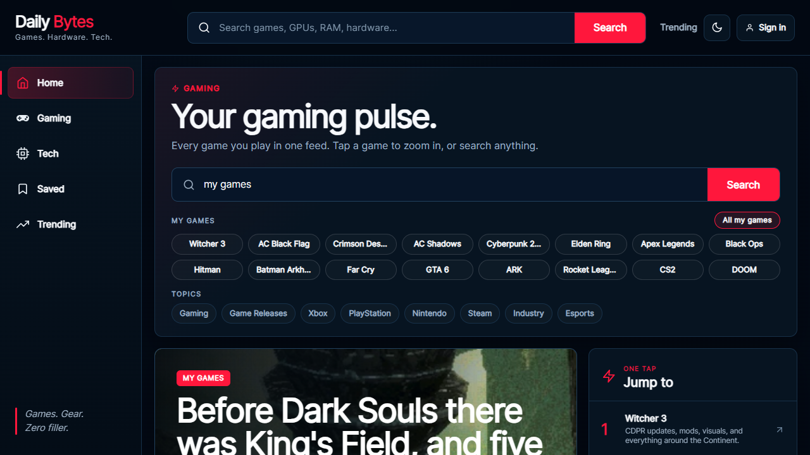

# Daily Bytes

Games. Hardware. Tech. A gaming and tech news dashboard.

[](https://the-daily-bytes-o4jo.onrender.com)



Daily Bytes is a gaming- and tech-first news dashboard built around the topics I actually follow: games, Witcher/CDPR, NVIDIA/RTX and AMD/Radeon hardware, GPU pricing, RAM/DDR5/SSD pricing, and enthusiast PC hardware.

The app is a React + Express project with a server-side news proxy, MongoDB-backed reader accounts and saved articles, and a one-click demo session for portfolio visitors.

## Live App

**https://the-daily-bytes-o4jo.onrender.com**

## Highlights

- **Gaming and Tech hubs** with quick-jump shortcuts for the games and hardware topics I follow (Witcher 3, NVIDIA/RTX, AMD/Radeon, GPU prices, RAM/SSD, PC hardware).
- **One-request default feed expansion** so the homepage can surface gaming and priority PC-hardware stories without multiplying provider calls.
- **Server-side relevance ranking and deduplication** for stronger keyword matches, duplicate headlines, URL duplicates, and freshness tie-breaking.
- **Global search** with focused query routes and synchronized navigation state.
- **MongoDB authentication** with bcrypt password hashing and 12-hour JWT sessions.
- **Passwordless portfolio demo access** issued server-side without exposing the demo credential in React.
- **MongoDB saved articles** with per-user unique URL protection.
- **15-minute bounded news cache** to reduce repeat Mediastack requests, with a stale-cache fallback so a provider hiccup does not blank the page.
- **Free RSS fallback** (IGN, PC Gamer, GameSpot, Eurogamer and others) for gaming and tech queries when Mediastack is rate limited, failing, or empty.
- **Resilient article images** that fall back to branded card art instead of browser broken-image icons.
- **Trending Watch and category feeds** with real loading, error, empty, retry, and pagination states.
- **Daily Horoscope extra** using a server-side API proxy with validated zodiac input and honest provider-backed fields.
- **Responsive dark/light presentation** with a compact mobile navigation layout.

## Stack

### Client
- React 18
- TypeScript
- Vite
- React Router
- React Icons

### Server
- Node.js
- Express
- TypeScript
- MongoDB Atlas
- bcrypt
- JSON Web Tokens
- Axios

### External Services
- Mediastack for news data (plus free RSS feeds as a fallback)
- API Ninjas for horoscope data
- Render for deployment

## Project Structure

```text
The-Daily-Bytes/
├── client/                 React/Vite application
│   ├── src/api/            Browser API clients
│   ├── src/components/     Shared navigation/news UI
│   ├── src/pages/          Feed, auth, saved, horoscope, category pages
│   ├── src/utils/          Small testable client utilities
│   └── tests/              Native Node regression tests
├── server/                 Express API and production server
│   ├── src/config/         MongoDB connection and indexes
│   ├── src/lib/            Ranking, pagination, auth, cache helpers
│   ├── src/routes/         Auth/news/saved/horoscope endpoints
│   └── tests/              Native Node regression tests
└── docs/superpowers/       Design and implementation notes for major passes
```

## Local Setup

### 1. Clone

```bash
git clone https://github.com/PHTMGatt/The-Daily-Bytes.git
cd The-Daily-Bytes
```

### 2. Install

The root install script installs both server and client dependencies.

```bash
npm install
```

### 3. Configure environment variables

Requires **Node.js 20+** and a MongoDB database (Atlas or local).

| Variable | Required | Notes |
| --- | --- | --- |
| `MONGODB_URI` | yes | Server exits with `MONGODB_URI is required` without it |
| `MONGODB_DB` | no | Defaults to `daily-bytes` |
| `JWT_SECRET_KEY` | yes | Signs reader sessions |
| `MEDIASTACK_API_KEY` | yes, for news | Without it `/api/news` answers `503 News service is not configured` (RSS is only a fallback when Mediastack fails) |
| `API_NINJAS_KEY` | no | Without it `/api/horoscope` answers `503` |
| `DEMO_PASSWORD` | no | Production generates a random one when unset; local dev uses a built-in default |
| `PORT` | no | Defaults to `3001` |

Set `MONGODB_URI`, `MONGODB_DB` and `MEDIASTACK_API_KEY` as real environment variables (in your shell, or in the Render dashboard). The server reads those three while its modules load, before `dotenv` loads `server/.env`, so values for them in that file are ignored. `JWT_SECRET_KEY`, `API_NINJAS_KEY`, `DEMO_PASSWORD` and `PORT` can live in `server/.env`.

Do not commit real credentials.

### 4. Development

```bash
npm run start:dev
```

This runs the Express API on port `3001` (nodemon) and, once it is up, the Vite dev server on `http://localhost:3000`, which proxies `/api` to the server.

### 5. Production build

```bash
npm run build
npm start         # node server/dist/server.js on PORT (default 3001)
```

`npm run build` is also the test gate: it runs the client tests, builds the React app, then compiles the server and runs the server tests. `npm start` does not rebuild, so run `npm run build` first. Render runs `npm run render-build`, then `npm start`.

## API Overview

```text
POST /api/auth/login
POST /api/auth/register
POST /api/auth/demo
GET  /api/news/:category?
GET  /api/saved
POST /api/saved
DELETE /api/saved
GET  /api/horoscope
GET  /api/health
```

News provider credentials stay server-side; the React client never receives the Mediastack API key.

## Data

MongoDB uses the `daily-bytes` database with:

- `users` — normalized reader accounts and bcrypt password hashes
- `saved_articles` — authenticated reading-list items with a unique user + URL index

The demo account is seeded during server startup and receives the same ordinary reader session shape as normal accounts.

## Testing

```bash
npm test
```

The root test command runs both client and server native Node test suites (the server suite compiles the TypeScript first). Lint the client with `cd client && npm run lint`.

CI: `validate.yml` runs `npm ci` and `npm run build` on every pull request; the `security-*` workflows add secrets, audit and deeper scans.

## Deployment

Daily Bytes is deployed as a Render web service. The Express server serves the built Vite assets and handles `/api/*` routes from the same service.

**Live:** https://the-daily-bytes-o4jo.onrender.com

## Repository

**GitHub:** https://github.com/PHTMGatt/The-Daily-Bytes
